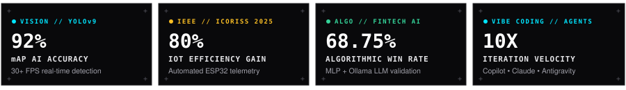

  

    
    
    
  

  <h1>Crafting <i>Intelligent</i> Systems &amp; Scalable <i>Software</i>.</h1>

  

    <code>ZERY GALLANTA SASONGKO — SOFTWARE ENGINEER, MOBILE DEVELOPER &amp; CREATIVE TECHNOLOGIST</code>
  

  

    
  

  

    
    
    
    
    
  

   

  

 

---

### `01 // ARCHIVE & TELEMETRY` — Experience & Credentials

> Pairing modern software engineering with autonomous AI workflows — building high-performance mobile applications, robust web services, and intelligent IoT systems with **GitHub Copilot**, **Claude AI 3.7**, and **Google Antigravity**.

<table>
  <tr>
    <td valign="top" width="60%">
      <h4>🏢 PT Petrokimia Gresik — <code>IT Engineering Intern</code></h4>
      
<b>2024 – Present</b> • <code>STATUS: ACTIVE</code> • <code>ENTERPRISE NODE</code>

      

        Overhauled enterprise frontend workflows and restructured internal engineering dashboards using <b>Flutter</b> and <b>React.js</b>, significantly cutting operational latency and standardizing data processing across cross-divisional corporate teams.
      

      <ul>
        <li>Collaborated with enterprise divisions to model system requirements and formulate technical architecture diagrams.</li>
        <li>Enforced strict engineering discipline: Modular Clean Architecture, code reviews, REST API integration, and automated QA testing.</li>
      </ul>
    </td>
    <td valign="top" width="40%">
      <h4>🎓 Academic &amp; Research</h4>
      

        <b>BINUS UNIVERSITY</b> 
        <code>B.S. in Computer Science</code> • Expected 2027
      

      

      

        <b>📜 ICORISS 2025 (IEEE Verified)</b> 
        Published research contribution &amp; system architecture patent for the <i>IoT Eco-Enzyme Automated Telemetry System</i>.  
        
      

    </td>
  </tr>
  <tr>
    <td colspan="2">
      <h4>⚡ AI-Native Engineering <i>// vibe coding</i></h4>
      

        Operating as an <b>AI-Native Vibe Coder</b> — orchestrating multiple autonomous LLM agents (<b>GitHub Copilot</b>, <b>Claude AI 3.7</b>, and <b>Google Antigravity</b>) with strict architectural verification to write, test, and refactor production-ready codebases at <b>10x iteration velocity</b>.
      

    </td>
  </tr>
</table>

---

### `02 // SELECTED BLUEPRINTS` — Featured Engineering Works

<table>
  <tr>
    <td valign="top" width="33%">
      
<code>COMPUTER VISION // AI</code>

      <h4>🎯 Real-Time Vehicle Detection System</h4>
      

        Engineered an end-to-end computer vision pipeline achieving <b>92% mAP at 30+ FPS</b>. Integrated model quantization for embedded efficiency and deployed an interactive real-time dashboard for per-zone traffic analytics.
      

      

        <code>Python</code> <code>YOLOv9</code> <code>OpenCV</code> <code>PyTorch</code>
      

      

        
      

    </td>
    <td valign="top" width="33%">
      
<code>IOT // EMBEDDED AI</code>

      <h4>🌱 IoT Eco-Enzyme Monitoring System</h4>
      

        Designed and engineered an automated sensor-integrated microcontroller node for real-time pH and temperature telemetry. Sliced manual monitoring overhead by <b>80%</b>. Certified and published by <b>IEEE ICORISS 2025</b>.
      

      

        <code>ESP32</code> <code>MQTT</code> <code>React.js</code> <code>TensorFlow</code>
      

      

        
      

    </td>
    <td valign="top" width="34%">
      
<code>MACHINE LEARNING // FINTECH</code>

      <h4>📈 Autonomous Trading Bot System</h4>
      

        Developed ML-driven (<b>MLP Classifier</b>) crypto bots (Tokocrypto) and local LLM-validated (<b>Qwen 3.5 via Ollama</b>) Forex bots for MT5, achieving a <b>68.75% win rate</b> in 6-month backtests with automated risk management &amp; Telegram control.
      

      

        <code>Python</code> <code>Scikit-Learn</code> <code>MT5</code> <code>Ollama LLM</code> <code>CCXT</code>
      

      

        
      

    </td>
  </tr>
  <tr>
    <td colspan="3">
      

        

          📸 <b>03 // STUDIO PORTFOLIO (Visual Direction &amp; Photography)</b> — Commercial framing, editorial visual narratives, and calibrated color grading with the <b>Nikon D750</b>. 
          🌐 Explore the full interactive blueprint showcase &amp; photography gallery at <a href="https://zery-gallanta.vercel.app/#projects"><b>zery-gallanta.vercel.app</b></a> • <a href="https://github.com/Zery-Gallanta/cv-website"><b>Portfolio Source Code (cv-website) ↗</b></a>
        

      

    </td>
  </tr>
</table>

---

### `03 // TAXONOMY & TOOLING` — Engineered Stack Architecture

<table>
  <tr>
    <td valign="top" width="50%">
      <h4><code>01 //</code> 🤖 AI &amp; Autonomous Tooling</h4>
      
      
      
      
    </td>
    <td valign="top" width="50%">
      <h4><code>02 //</code> 📱 Mobile &amp; Frontend</h4>
      
      
      
      
      
    </td>
  </tr>
  <tr>
    <td valign="top" width="50%">
      <h4><code>03 //</code> 🧠 AI, Vision &amp; Embedded IoT</h4>
      
      
      
      
      
      
    </td>
    <td valign="top" width="50%">
      <h4><code>04 //</code> 🏗️ Backend &amp; Systems</h4>
      
      
      
      
      
      
    </td>
  </tr>
</table>

---

### `04 // SYSTEM TELEMETRY` — GitHub Analytics

  <table border="0">
    <tr>
      <td align="center" width="50%">
        
      </td>
      <td align="center" width="50%">
        
      </td>
    </tr>
  </table>

   

  

    

  

